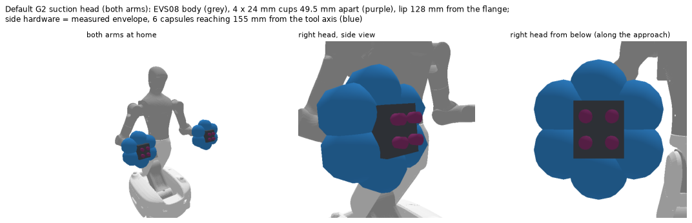
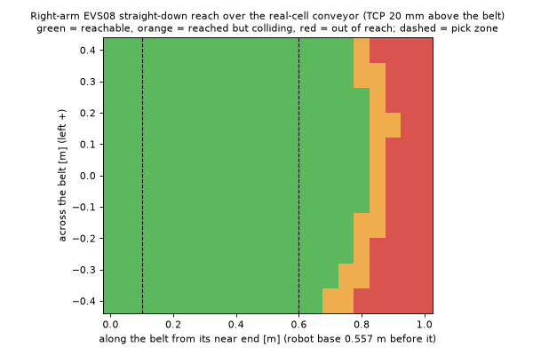
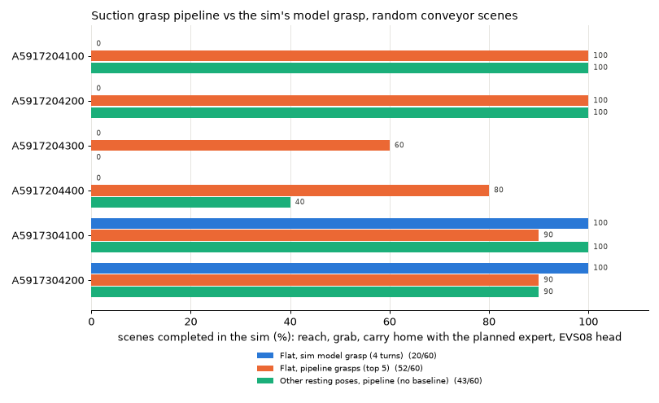

# Suction grasp pipeline (G2, EVS08 head)

The pipeline chooses suction grasps for sheet-metal parts on the Agibot G2. It works in two phases:

| Phase | When | Input | Output |
|---|---|---|---|
| 1. Grasp database (`build_grasp_db.py`) | Offline, once per part | Gripper model + part CAD mesh | Ranked, validated grasps in the part's CAD frame |
| 2. Grasp selection (`select_grasp.py`) | Execution time, per pick | Part ID, part pose in the robot base frame, scene (support plane, obstacle boxes), current joints | Ranked grasps in the base frame, each with a collision-free right-arm IK posture (pre-grasp, approach, grasp) |

Nothing here moves a robot. Phase 2 only computes poses and joint angles; dry runs can be drawn as pictures.
The design, the decisions and the full development log are in [PLAN.md](PLAN.md).

---

## Gripper

The head is a JODELL EVS08 vacuum gripper with four custom 1.5-bellows cups (24 mm lip). Since 2026-10-22 it is
the default head on both arms for the G2 models in this project and in `g2_pybullet_sim`. Measured on the robot
where possible:
- flange → uncompressed cup lip 128 mm;
- cups in a 49.5 mm square;
- vacuum 75 kPa (the EVS08's maximum).

The side hardware (vacuum generators, hand camera) is modelled with the conservative outline the real-robot pick
project uses: six capsules reaching 155 mm from the tool axis (blue below).



- **Single source:** the head is built in the sim (`g2_pybullet_sim/build_evs08.py`), and `tools/copy_robot.py`
  copies the URDF, meshes and SRDF here.
- `gripper.json` holds the tool frame, cup layout, seal rule, hold check and outline used by the code.
- **Tool frame:** origin at the centre of the cup square in the lip plane, axes = flange axes, +z = approach.

## Frames

- **Part frame = CAD frame:** the mesh from the pose-estimation service's `models/`, plus `cad_center_mm`. The
  service reports `T_base_cad_mm`, which phase 2 takes directly (mm → m).
- **Grasp:** a tool pose in the part frame (4 × 4).

---

## Assets (not in the repository)

The repository holds code and docs only. Three things have to be put in place before running anything:
- **Part meshes** (`assets/parts_src/`): copy them from the pose-estimation service's `models/` folder:
  - `obj_XXXXXX.ply` for the parts used (mm, centred on their bounding box);
  - `parts.json`.

  (`stable_poses.json` is not needed: the stable poses are computed.)

  `mesh_io.SMALL` lists the 6 small parts. Their collision models (`assets/parts/`) are built on first use.
- **Robot model** (`assets/robot/`): `tools/copy_robot.py` copies the G2 with the EVS08 head from a
  `g2_pybullet_sim` checkout (a `g2_pybullet_sim` folder next to this repository by default; `--sim` to change).
- **Grasp databases** (`db/`): built by `build_grasp_db.py`, below.

`validate_in_sim.py` also needs a `g2_pybullet_sim` checkout with its own `.venv`. Its location is
a `g2_pybullet_sim` folder next to this repository by default, or the `G2_SIM` environment variable. The figures `gripper_model.png`
and `conveyor_reach.png` come from that sim.

## Usage

```bash
python3 -m venv .venv && .venv/bin/pip install -r requirements.txt
```

```bash
.venv/bin/python tools/copy_robot.py
```

```bash
.venv/bin/python build_grasp_db.py --workers 3
```

```bash
.venv/bin/python select_grasp.py examples/request_A5917204300.json --render dry_run.png
```

The steps are, in order:
1. set up the environment;
2. copy the robot model from the sim (again whenever the head changes);
3. build the phase 1 databases (`db/<part>.npz`, `.json`, `_grasps.png`; about 2–8 minutes per part, 3 parts at a time);
4. run phase 2 on a request: JSON in, ranked grasps out, with an optional dry-run picture.

Run everything under a 6 GB memory cap, for example `systemd-run --user --scope -p MemoryMax=6G ...`.
From Python:

```python
from select_grasp import Selector
sel = Selector("A5917204100")
grasps, info = sel.select(T_base_part, support={"point": [x, y, z], "normal": [0, 0, 1]}, boxes=[...], k=5)
grasps[0]["T_flange"], grasps[0]["q_grasp"]          # flange pose to command, IK joints found
sel.close()                                          # frees the PyBullet worlds
```

### Tests and checks

| Command | What it checks | Status |
|---|---|---|
| `tests/test_seal.py` | Seal rule and hold check on synthetic shapes (holes, edges, nuts, tilts, cylinders) | 20/20 |
| `tests/test_collide.py` | Head collision at the grasp and on the approach (channel, walls, overhangs, support plane) | 13/13 |
| `tests/test_mesh_io.py` | Part meshes match the pose estimator's models; checker speed | 7/7 |
| `tests/check_db.py` | Every saved grasp re-seals and is collision-free; resting-pose tags reproduce; coverage | 22/24 (see open items) |
| `tests/eval_select.py` | Phase 2 on 204 random real-cell conveyor scenes, with and without pose noise | below |
| `validate_in_sim.py` | Full pick task in `g2_pybullet_sim` (reach, grab, carry home) | below |

---

## How it works

### Phase 1: grasp database

1. **Load and clean the part.** Load it in the CAD frame (closed 2 mm steel solid with 3 weld nuts) and compute mass and centre of mass.
2. **Stable resting poses.** Find them with trimesh; they are identical to the pose estimator's list.
3. **Sample candidates.** 10,000 surface points × 24 turns of the head over 360° = 240,000 candidates per part. The cup square repeats every 90°, but the head doesn't.
4. **Seal rule, per cup.** 25 rays (centre, 8 at half the radius, 16 on the lip), cast with PyBullet's batched ray test on the exact mesh. A cup seals if:
   - all rays hit within ±5 mm of the lip plane;
   - the hits lie within 1.5 mm of a plane;
   - that plane is within 30° of the cup axis.

   A grasp needs 3 of 4 cups to seal.
5. **Collision.** The head must clear the part at the grasp and along a 100 mm straight approach.
6. **Hold.** The sealed cups must hold 1.5 × the part's weight with the gripper pointing down.
7. **Robustness.** The fraction of 10 perturbed copies (±2 mm, up to 3°) that still pass steps 4–5. Quality = robustness × hold margin.
8. **Resting-pose tags.** In each stable pose, the approach must be within 60° of down, and the head must clear the support plane.
9. **Pruning.** Non-maximum suppression (5 mm, 10°, 25° turn), keeping up to 1000 grasps per part.

`build_grasp_db.py` draws each database as `db/<part>_grasps.png`: the part seen from above in every resting pose, with the usable grasps as dots coloured by quality and the best spots as cup squares.

### Phase 2: grasp selection

1. **Transform.** Move the database grasps into the base frame.
2. **Resting pose.** Find the stable pose whose down direction matches the support normal (within 15°) and use its tagged grasps.
3. **Fast filters.** The approach must be within 60° of down, and the head outline must stay above the support at the grasp and the pre-grasp.
4. **IK** (right arm + body lift/waist joints): pre-grasp 100 mm back, 4 approach points, then the grasp.
   - Joints at least 5° inside their limits.
   - The part, scene boxes and floor are obstacles; the cups may touch the part only at the grasp.
   - Grasps whose tool x axis heads within ±75° of 120° (base frame) are tried first. The wrist (joint 7 ±88°, joint 6 ±58°) can't reach most other turns.
5. **Fallback.** Only if nothing is reachable: a guided local search. It turns and shifts the best database grasps and re-checks them online (seal, hold, collision, robustness) before IK.
6. **Rank.** Score = quality − small costs for tilt, wrist turn from the current joints, and closeness to joint limits.

`select_grasp.py --render` (and `tests/eval_select.py`) draw the chosen grasp's IK posture with the part and the conveyor as a dry-run picture.

---

## Results (2026-10-22: EVS08 measured head, real-cell conveyor)

**Real cell.** The robot stands at the conveyor's near end, facing along it, with the belt top at 0.783 m. The
belt is 0.88 m wide, its centre 0.09 m to the robot's right, and its near end 0.557 m in front of the robot base.
These come from the real robot's head-camera depth scenes. The right arm reaches the whole belt width out to about
0.75–0.8 m past the near end:



### Phase 1

| Part | Seal | + collision-free | Saved | Grasps per resting pose |
|---|---|---|---|---|
| A5917204100 | 32,792 | 29,731 | 1000 | 478 / 522 |
| A5917204200 | 33,416 | 30,564 | 1000 | 459 / 541 |
| A5917204300 | 26,264 | 1,242 | 221 | 221 / **0** / **0** |
| A5917204400 | 26,668 | 1,208 | 219 | 215 / **4** / **4** |
| A5917304100 | 18,952 | 8,850 | 1000 | 792 / 208 |
| A5917304200 | 18,488 | 9,000 | 1000 | 795 / 205 |

Database grasps checked against the sim's own cup rule: 2,940 of 2,960 pass.

### Phase 2 (`tests/eval_select.py`, 34 random real-cell scenes per part)

| Part | Scenes with a grasp | Chosen grasp holds (true pose) | With ±2 mm / ±2° pose error | Median / 95th pct time |
|---|---|---|---|---|
| A5917204100 | 34/34 | 34/34 | 34/34 | 0.38 / 1.46 s |
| A5917204200 | 34/34 | 34/34 | 33/34 | 0.44 / 1.60 s |
| A5917204300 | 14/34 | 14/14 | 13/14 | 0.22 / 4.23 s |
| A5917204400 | 22/34 | 22/22 | 16/22 | 0.29 / 3.33 s |
| A5917304100 | 33/34 | 33/33 | 32/33 | 0.47 / 2.27 s |
| A5917304200 | 34/34 | 34/34 | 32/34 | 0.37 / 1.57 s |
| **All** | **171/204** | **171/171** | **160/171** | **0.37 / 2.22 s** |

### Full pick task in the sim (`validate_in_sim.py`, 10 flat + 10 other-pose scenes per part)

The task is reach, grab and carry home, using the sim's planned expert. The baseline is the sim's own single model
grasp, which was found for the old placeholder head.

| | Sim's model grasp | Pipeline (top 5 tried) |
|---|---|---|
| Part lying flat | 20/60 | **52/60 (87%)** |
| Other resting poses | — (none) | **43/60 (72%)** |



---

## Development history: issues and solutions

| Issue | Solution |
|---|---|
| The JT conversions of the CAD were lost | Used the pose estimator's own meshes (same frame as its poses); CAD frame = mesh + `cad_center_mm`, checked to 0.02 mm |
| trimesh ray casting: 16 ms per grasp, ran out of memory at 1000 grasps | PyBullet batched rays on the exact mesh: 0.15–0.3 ms per grasp, identical hits; grasps checked in chunks of 5000 |
| PyBullet hit normals always face the ray, so the "hit faces the cup" rule couldn't be checked | Covered by the collision check (the cups sweep every ray origin on the approach); tested |
| Mirrored twin parts gave very different databases | Turns sampled over 0–75° assumed 90° symmetry, but the head isn't symmetric; now 360° |
| A 300-grasp cap crowded around the centre of mass | Cap raised to 1000 |
| Gripper model changed three times (placeholder 40 mm head → sheet-based EVS08 → measured EVS08) | One head definition in the sim (`build_evs08.py`), copied here; databases rebuilt each time; old ones kept in `db_old_*` |
| Phase 2 IK reached nothing on the conveyor | The body lift/waist joints are needed too (as in the sim) |
| Phase 2 slow (median 1.16 s): most IK attempts failed on the wrist limits | Preferred heading order (median 0.37 s); nothing dropped |
| Pose noise turned about the CAD origin, 1–2 m from the part | Noise turned about the part's centre |
| The side-hardware outline overlaps the robot's own forearm and wrist (25 of 900 recorded real frames) | Self-collision of that outline against the arm's links 4–6 skipped (the real hardware cannot hit them) |
| Memory: PyBullet worlds are not freed by garbage collection | `Selector.close()`; one selector at a time in the validation |
| Pipeline and sim both have an `ik.py` | Validation runs each stage in its own process |
| Carry-home failures in the sim (tilted parts hung into the conveyor at the home pose) | Mostly gone since the conveyor matches the real cell (the hands at home are no longer over the belt) |

## Open items and future work

- **Side hardware outline.** The capsule ring (310 mm across) is a conservative envelope, not the real shape. It removes about 90% of the grasps on A5917204300/4400 and all of them in two of their resting poses (`check_db` 22/24). Measuring where the vacuum generators and the camera actually sit, and modelling them as boxes, is the next improvement.
- **Placeholders:**
  - seal tolerance (1.5 mm) and bellows travel (5 mm);
  - the EVS08's mounting angle on the flange and the 14 mm adapter;
  - conveyor length, bed depth, frame thickness, and the drive motor at the near-left corner (not modelled).
- **Not covered:**
  - a carry or place-pose check in phase 2 (the held part's clearance after the grasp);
  - neighbouring parts as obstacles;
  - the left arm;
  - motion planning beyond the reachability check.
- **The sim's own suction material** (model grasps, pools, demos, policies, learned suction scorer) was made with the old placeholder head and needs rebuilding. The sim's table pick test fails until then.
- **Real robot:** only dry runs so far, with poses from the pose-estimation service and a rendered posture; nothing has been sent to the arm.
