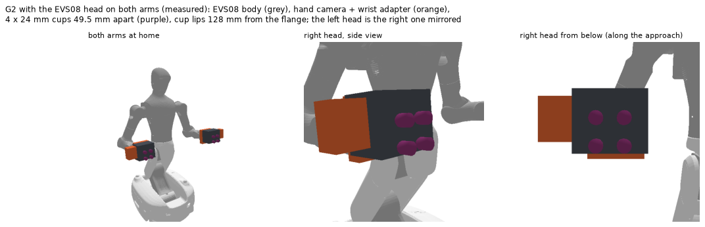
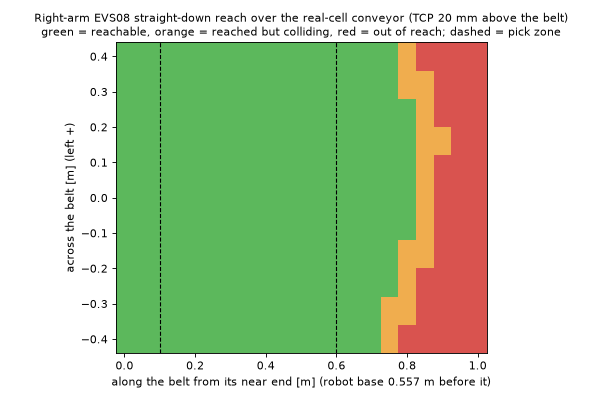
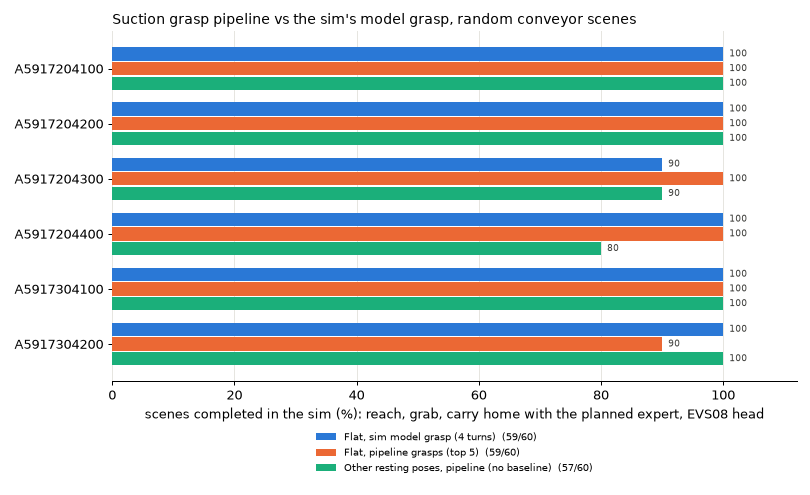

# Example: Agibot G2 with a JODELL EVS08 suction head

This example uses the generic pipeline on a real setup: six sheet-metal parts picked from a conveyor by the G2's
right arm.
- **Head:** JODELL EVS08 vacuum gripper with four custom 1.5-bellows cups (24 mm lip, 49.5 mm square), measured on the robot.
- **Phase 1:** the generic `build_db` with `gripper_evs08.json`.
- **Phase 2:** the generic `Selector`, plus a reachability plug-in (`g2_reach.py`). It runs PyBullet IK for the G2 (right arm + body lift/waist joints) and orders grasps by the turns the wrist can reach.

Nothing here moves a robot. Dry runs return poses and joint angles, and can draw a picture of the posture.

## Files

| File | Purpose |
|---|---|
| `gripper_evs08.json` | The head for the generic pipeline: cups, seal and hold settings, measured head boxes (EVS08 body, hand camera, wrist adapter) and an approximate wrist cylinder; plus the flange → tool mounting (128 mm) |
| `g2_parts.py` | The parts: meshes from the pose-estimation service, in the CAD frame it reports poses in |
| `build_dbs.py` | Phase 1 for the six parts |
| `g2_reach.py` | G2 reachability plug-in (IK at the pre-grasp, the approach and the grasp; part and obstacles as IK obstacles) and the wrist-heading order; dry-run render |
| `g2_select.py` | Phase 2 command line on a request in the pose estimator's format (`T_base_cad_mm`) |
| `scenes.py` | Random scenes of the real cell: the robot at the near end of a 0.88 m conveyor (belt top 0.783 m), parts in any stable pose |
| `eval_select.py` | Phase 2 on random scenes, with pose noise |
| `validate_in_sim.py` | The whole pick task (reach, grab, carry home) in the G2 simulation (`g2_pybullet_sim`) |
| `copy_robot.py`, `robot.py`, `ik.py` | The G2 robot model (copied from the simulation) and its IK |
| `DEVELOPMENT_LOG.md` | How this setup was developed: decisions, measurements and results along the way |

## Setup

```bash
.venv/bin/pip install -r examples/g2_evs08/requirements.txt
```

```bash
.venv/bin/python examples/g2_evs08/copy_robot.py --sim ../g2_pybullet_sim
```

```bash
.venv/bin/python examples/g2_evs08/build_dbs.py --workers 3
```

```bash
.venv/bin/python examples/g2_evs08/g2_select.py examples/g2_evs08/request_A5917204300.json --render dry_run.png
```

The steps are, in order:
1. install the extra dependencies (pybullet and scikit-learn);
2. copy the robot model from the simulation;
3. put the part meshes in `assets/parts_src/`: `obj_XXXXXX.ply` and `parts.json` from the pose-estimation service's models (not published);
4. build the databases;
5. run phase 2 on the example request.

`eval_select.py` and `validate_in_sim.py` produce the results below. The validation needs a `g2_pybullet_sim`
checkout with its own environment, set with `G2_SIM` (default: a folder next to the repository).

## Results

Run on 2026-10-23 with the generic pipeline (`build_dbs.py`, `eval_select.py`, `validate_in_sim.py`).



**The real cell.** The robot stands at the conveyor's near end, facing along it.
- The belt top is 0.783 m high and the belt 0.88 m wide, its centre 0.09 m to the robot's right.
- The near end is 0.557 m in front of the robot base.
- These come from the robot's head-camera depth scenes.

The right arm reaches the whole belt width out to about 0.75–0.8 m past the near end:



### Phase 1 (10,000 points × 24 turns = 240,000 candidates per part)

| Part | Seal | + collision-free | Saved | Grasps per resting pose | Time |
|---|---|---|---|---|---|
| A5917204100 | 32,788 | 31,995 | 1000 | 617 / 383 | 150 s |
| A5917204200 | 33,408 | 32,636 | 1000 | 616 / 384 | 153 s |
| A5917204300 | 26,264 | 7,824 | 1000 | 724 / 276 / 39 | 77 s |
| A5917204400 | 26,668 | 7,891 | 1000 | 722 / 278 / 37 | 77 s |
| A5917304100 | 18,948 | 13,652 | 1000 | 576 / 424 | 57 s |
| A5917304200 | 18,488 | 13,386 | 1000 | 587 / 413 | 55 s |

Database grasps checked against the simulation's own cup rule: 3,768 of 3,842 pass (98.1%).

### Phase 2 (`eval_select.py`, 34 random real-cell scenes per part, G2 reachability plug-in)

| Part | Scenes with a grasp | Chosen grasp holds (true pose) | With ±2 mm / ±2° pose error | Median / 95th pct time |
|---|---|---|---|---|
| A5917204100 | 34/34 | 34/34 | 33/34 | 0.27 / 0.77 s |
| A5917204200 | 34/34 | 34/34 | 34/34 | 0.29 / 0.76 s |
| A5917204300 | 26/34 | 26/26 | 26/26 | 0.81 / 5.60 s |
| A5917204400 | 29/34 | 29/29 | 29/29 | 0.38 / 5.26 s |
| A5917304100 | 33/34 | 33/33 | 33/33 | 0.38 / 1.97 s |
| A5917304200 | 34/34 | 34/34 | 34/34 | 0.20 / 1.02 s |
| **All** | **190/204** | **190/190** | **189/190** | **0.32 / 5.19 s** |

In the scenes without a grasp (13 of the 14 are A5917204300/4400), every candidate fails the G2 IK at the pre-grasp: wrist
joints near their limits, or out of reach. The local search runs to its budget there, which is where the slow
calls come from.

### The whole pick task in the simulation (`validate_in_sim.py`, 10 flat + 10 other-pose scenes per part)

The task is reach, grab and carry home, with the simulation's planned expert. The baseline is the simulation's
single model grasp per part.

| | Simulation's model grasp | Pipeline (top 5 tried) |
|---|---|---|
| Part lying flat | 59/60 | **59/60** |
| Other resting poses | — (none) | **57/60** |



## Open items

- **Placeholders:**
  - seal tolerance (1.5 mm) and bellows travel (5 mm);
  - the body face at 99 mm (the head scan's box reached 120 mm, most likely including the cup tops);
  - the wrist cylinder (approximate);
  - the left head (the right one mirrored, not scanned).
- **The loose cable on the head's −y side is not modelled.**
- **Real robot:** only dry runs so far; nothing has been sent to the arm.
